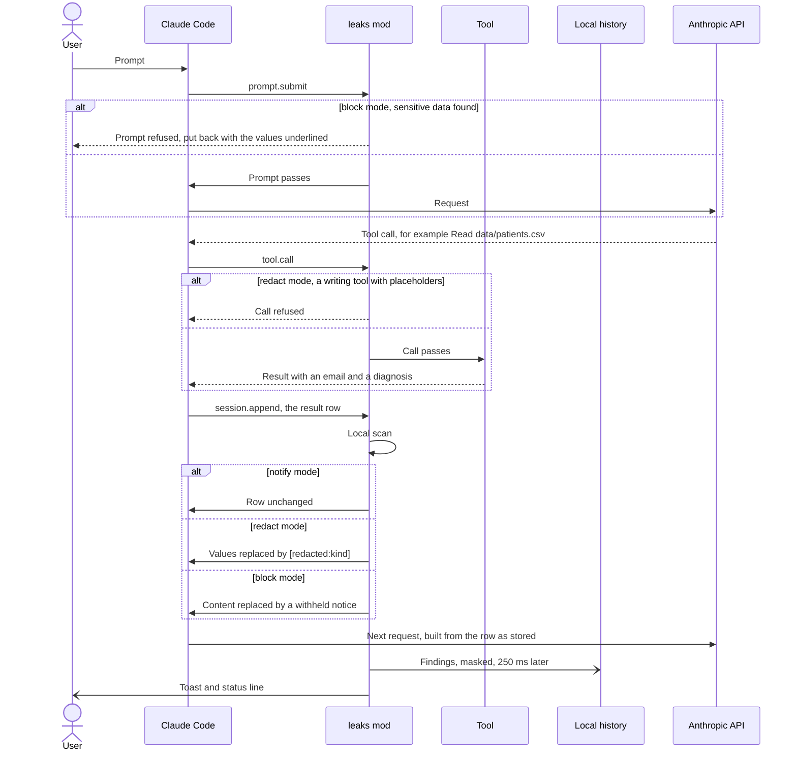

# leaks

Watches everything the model reads or writes for private and medical data. By default each value is replaced by a placeholder before it leaves your machine; you get a notification, and each project keeps a list of what was found, when and through which source. Two other modes only record it, or withhold the whole content.

| | |
| --- | --- |
| Use | `/some-leaks` opens the pane |
| Watches | Your prompts, tool results, files and context added to the conversation, the model's replies and tool inputs, subagents, other mods' side model calls |
| Detects | Emails, phone numbers, IBANs, card numbers, French social security numbers, US SSNs, dates of birth, health terms |
| Notifies | Once per value and session, by toast, system notification, both or off |
| Modes | `redact` (default), `notify`, `block` |
| Changes Claude's behaviour | Yes by default: `redact` and `block` change what the model reads; `notify` changes nothing |
| Settings | `mode`, `failClosed`, `notify`, `storeRawValues`, `ignore`, `retentionDays` |

## Behaviour

- Every row the conversation keeps is scanned before it is stored, and the API request is built from the row as stored
- Detection runs locally, inside Claude Code: no model, no remote service, no network call
- Only the scan runs in the conversation's path (about 0.4 ms for a 20 KB file, under 1 ms for 200 KB of unbroken text: every pattern runs in linear time); findings are stored and notified 250 ms later, off that path, and anything still waiting is written when the session ends
- Rows the model never reads (notices) and compaction summaries are skipped
- A project is the git repository's root folder name, or the session folder's name outside git
- Each distinct value is one finding per project, with its count, first and last time, and its 20 latest occurrences
- A value seen again in the same session is counted, not notified again
- A status line keeps the number of sensitive items seen this session

**Changes Claude's behaviour:** yes by default. In `redact` (the default) and `block` modes the model reads placeholders or a withheld notice instead of the data, and some prompts and writes are refused. Every such change is notified and listed in the pane. In `notify` mode nothing is changed.

## Modes

| Mode | Prompts | Tool results and context | Side model calls | What reaches the API |
| --- | --- | --- | --- | --- |
| `redact` (default) | Values replaced by `[redacted:<kind>]` | Values replaced by `[redacted:<kind>]` | Values replaced | Placeholders only |
| `notify` | Sent as typed | Kept as read | Sent as written | Everything |
| `block` | Refused, put back in the prompt box with the values underlined | Whole content replaced by a withheld notice | Refused | A notice naming the kinds found |

- The model's own replies and tool inputs are recorded, never rewritten: they come from the API, not from your machine
- In `redact` mode, `Write`, `Edit`, `MultiEdit`, `NotebookEdit` and `Bash` calls whose input holds a placeholder are refused, so the model cannot write placeholders back over the real values
- `redact` breaks tasks that need the real value, such as editing the lines of a file that hold it
- `block` stops Claude from working on files that hold such data at all
- Images and PDFs are not scanned, and some attached context is sent as recorded by the engine
- The session transcript on disk keeps the tool's original output; it stays on your machine
- Pattern detection catches known formats only: for data that must never leave, also deny Claude access to those folders with a permission rule

## Security Limits

| Limit | Why |
| --- | --- |
| Known formats only | Names, postal addresses, free-text medical narratives, other languages and encoded data (base64, hex) are not detected |
| Not adversarial | Redaction stops accidents, not a model working around it: a prompt injection can make the model transform data (for example `base64 file.csv`) so no pattern matches |
| Images and PDFs | Not scanned; in `redact` mode they reach the model as they are |
| Fixed context | Some attached context is sent as recorded by the engine and cannot be rewritten |
| System prompt and internal calls | Not verified: the system prompt, and model calls Claude Code makes on its own (such as summarizing a fetched page), may not pass through the mod |
| Local transcript | The session file on disk keeps the tool's original output |
| Same access as Claude Code | Like every mod it is not sandboxed; read the diff of a new version before `claude plugin update` |

- The mod makes no network call; everything it stores stays in `~/.claude/plugins/store`, readable by your user only
- In `notify` mode, or with `failClosed` off, a scan that fails lets the content through
- For data that must never leave, also deny Claude access to those folders with a permission rule

## How It Works



- `prompt.submit`, `tool.call` and `session.append` all run on your machine, before the request is sent
- Side model calls from other mods go through `model.complete` and `model.fork` and get the same treatment
- Subagents append their rows the same way

## Sources

| Source | Shown as |
| --- | --- |
| Your prompt | Sent by you: prompt |
| A tool result | Read by a tool: `Read data/patients.csv`, `Bash`, `WebFetch example.org` |
| The model's reply or tool input | Written by the model: reply, `Write src/seed.ts` |
| Files mentioned, memory, hook context | Added as context: the attachment type |
| Another mod's `$.model.complete` or `$.model.fork` | Side model call |

Subagent rows carry `(subagent)` after the source.

Sources keep the tool and the file path, or the host of a URL. Commands, search patterns and full URLs are never stored: they can hold tokens or passwords.

## Detection

| Kind | Category | Rule | Shown as |
| --- | --- | --- | --- |
| Email | private | Address with a real top-level domain (`logo@2x.png` skipped) | `j***@gmail.com` |
| Phone | private | French numbers (`06 12 34 56 78`, `+33 ...`), other `+` numbers of 8 to 15 digits | last 2 digits |
| IBAN | private | Checksum verified | country, key and last 4 |
| Card number | private | 13 to 19 digits, Luhn verified | last 4 |
| Social security (FR) | private | NIR with a valid key | first digit and key |
| SSN (US) | private | `123-45-6789` form, invalid ranges skipped | last 4 |
| Date of birth | private | A date after "date of birth", "DOB", "born on", "né le", "date de naissance" | year only |
| Health term | medical | Conditions, treatments, medical records, sick leave, common drugs, ICD-10 codes, in English and French | the term |

- Acronyms (`HIV`, `AIDS`, `ADHD`, `IVG`) match in capitals only, so "this aids the reader" is skipped
- "diagnostic" and "diagnostics" are skipped (too common in code); "diagnosis" and "diagnosed with" are kept
- Health terms flag a topic, not a person: a README about a diabetes app will show up
- The mod's own `hooks/detect.ts` holds the whole term list: `plugins/leaks/hooks` is in the default `ignore`, so reading the mod's sources is not flagged, and in `redact` mode they reach the model whole

## Pane

| Control | Hotkey |
| --- | --- |
| Findings: one entry per value, latest first, with count, first and last time, latest source | `f` |
| Timeline: the 100 latest occurrences, with time and source | `t` |
| Filter all, private, medical | `a` / `p` / `m` |
| Another project | project picker |
| Clear the project's history | "Clear project", then confirm |

Each occurrence says what was done with it: `seen`, `redacted` or `blocked`. The current mode shows under the project name.

## Settings

| Setting | Type | Default | Description |
| --- | --- | --- | --- |
| `mode` | `redact`, `notify`, `block` | `redact` | What happens to data found: replaced by placeholders, recorded only, or withheld |
| `failClosed` | boolean | `true` | In `redact` and `block` modes, a scan that fails or runs out of time withholds the content (or refuses the prompt or side call) instead of letting it through |
| `notify` | `toast`, `system`, `both`, `off` | `toast` | How a new finding is announced |
| `storeRawValues` | boolean | `false` | Keep full values in the history instead of masked ones |
| `ignore` | string | `example.com,example.org,example.net,noreply,no-reply,git@github.com,git@gitlab.com,plugins/leaks/hooks` | Comma-separated texts; a finding whose value or source contains one is skipped |
| `retentionDays` | number | `90` | Days of occurrences kept; older ones are deleted when a session starts |

Change them, then restart Claude Code:

```bash
echo '{"mode":"notify","notify":"both","ignore":"example.com,mycompany.com"}' | claude plugin configure leaks@somelife-claude-mods --values-stdin
```

## Trying It

`fixtures/patients.csv` holds made-up people with emails, phones, an IBAN, dates of birth and conditions. Start a session with the mod, from the repository root:

```bash
claude --plugin-dir plugins/leaks
```

| Step | Do | Expect |
| --- | --- | --- |
| 1 | Send `My email is jane.doe@gmail.com and I was diagnosed with diabetes. Just reply OK.` | A "Sensitive data redacted" toast; Claude reads `My email is [redacted:email] and I was [redacted:health] [redacted:health]` |
| 2 | Ask `Read plugins/leaks/fixtures/patients.csv and quote its emails` | Claude only sees `[redacted:email]`; the toast names `Read plugins/leaks/fixtures/patients.csv` |
| 3 | Ask Claude to write that content back to the file | The write is refused |
| 4 | Run `/some-leaks` | Emails, phones, IBAN, dates of birth and health terms, each `redacted` |
| 5 | Set `mode` to `notify`, restart, then send the prompt of step 1 | A "Sensitive data seen" toast; Claude reads the prompt as typed |
| 6 | Set `mode` to `block`, restart, then send a prompt holding `4111 1111 1111 1111` | The prompt is refused and put back in the box, the number underlined |
| 7 | Ask Claude to read the file | Claude only gets the withheld notice |

- Change `mode` in `/config` inside a session, or with `claude plugin configure leaks@somelife-claude-mods --values-stdin` from a shell, then restart Claude Code
- A value is notified once per session: later steps count it in the pane without a new toast
- A dim `leaks:` line in the transcript means a hook failed or the module did not load
- Automated tests: `claude plugin test plugins/leaks`

## Data

- Stored in the mod's own store under the Claude Code configuration directory, one entry per project
- Values are masked before storage unless `storeRawValues` is on
- Each value is recognised again by a 96-bit SHA-256 id, keyed with a random secret made on first use: without the secret, ids cannot be matched against guessed values, nor compared across machines
- The secret is kept in the same store: whoever can read the store can still test guesses one value at a time
- Notifications show masked values only
- Up to 300 findings per project, the oldest dropped first
- Nothing leaves your machine
- Detection is pattern based: expect some false positives, and values written in unusual formats are missed
